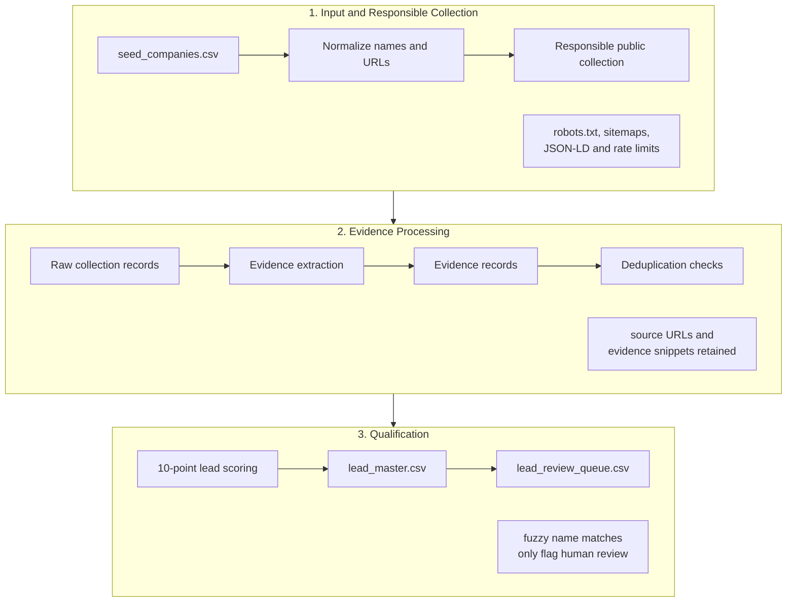

# Data Intelligence Challenge

An evidence-first Python 3.11 command-line pipeline for the Decode Age Data Intelligence Intern task.

The pipeline starts from messy seed company URLs, collects only permitted public web evidence, extracts traceable company signals, deduplicates cautiously, scores leads, and writes CSV outputs for human business review. It is not a web app or API, and it does not perform outreach.

For the detailed methodology, see [workflow_note.md](workflow_note.md).

## Pipeline at a Glance



Normal public pages are collected using Python `urllib` and analysed through a shared BeautifulSoup parser. Playwright is available only as an optional renderer for permitted sparse JavaScript application shells. The rendered HTML, when needed, is returned to the same BeautifulSoup extraction path.

## Latest Run Snapshot

```text
=== Pipeline Summary ===
Mode: live public collection
Input: 18 seeds

Deduplication: 0 exact-domain groups | 1 similar-name candidate
Collection: 90 attempted | 78 fetched | 0 blocked by robots.txt | 5 restricted/gated | 0 rate-limited | 7 failed
Extraction: 584 deduplicated evidence records
Qualification: 13 qualified | 2 pending review | 2 not a fit | 1 insufficient information
Outputs: 18 lead-master rows | 15 review-queue rows

Runtime: urllib + BeautifulSoup (html.parser)
Browser rendering fallback: enabled, not needed

Saved to: D:\2026-27\Tasks\DecodeAge\Data_Intelligence_Task\data-intelligence-challenge
```

These are the latest generated results in the repository. Browser rendering was enabled for the run but was not invoked because no page met the fallback eligibility conditions.

## Outputs

| File | Purpose |
| --- | --- |
| `lead_master.csv` | Final structured lead dataset with one row per seed company |
| `lead_review_queue.csv` | Evidence-backed leads ready for business review |
| `data/evidence/evidence_records.csv` | One source-backed evidence row per extracted fact |
| `data/raw/collection_records.jsonl` | Raw structured page collection records |
| `data/raw/collection_log.csv` | Collection log with status, redirects, errors, and timestamps |
| `workflow_note.md` | Detailed methodology and handling notes |

Raw files are the audit trail. The lead CSVs are the processed outputs.

## Setup

```bash
cd data-intelligence-challenge
python -m venv .venv
.venv\Scripts\activate
pip install -r requirements.txt
```

Playwright's Chromium browser is a separate one-time setup step:

```bash
playwright install chromium
```

## Run

Run tests:

```bash
python -m unittest discover -s tests
```

Run without live web collection:

```bash
python -m src.pipeline --input data/input/seed_companies.csv
```

Run with responsible public-web collection and progress logs:

```bash
python -m src.pipeline --input data/input/seed_companies.csv --collect-live --verbose
```

Run with optional browser rendering fallback:

```bash
python -m src.pipeline --input data/input/seed_companies.csv --collect-live --playwright-fallback --verbose --max-pages-per-domain 5 --timeout-seconds 10 --rate-limit-seconds 1.5 --browser-timeout-seconds 12 --browser-render-wait-ms 1000 --minimum-visible-text-chars 250
```

## Configuration

No `.env` file is required for the current pipeline because it does not use API keys, secrets, databases, or login-based services. Runtime settings are passed as CLI flags so collection behavior is visible and repeatable.

Important flags:

- `--collect-live` enables public web collection.
- `--playwright-fallback` enables optional browser rendering for eligible sparse app-shell pages.
- `--verbose` prints progress logs plus browser-rendering diagnostics.
- `--max-pages-per-domain` limits collection per company.
- `--timeout-seconds` controls normal HTTP request timeout.
- `--rate-limit-seconds` controls per-domain delay.
- `--browser-timeout-seconds` controls browser navigation timeout.
- `--minimum-visible-text-chars` controls when a sparse page may be considered for browser fallback.

`.env.example` is included only as a safe template placeholder for future local configuration.

## Tools Used

| Tool | Role | Used in final run? |
| --- | --- | --- |
| Python 3.11 | Runtime for the command-line pipeline | Yes |
| `urllib` | Normal public HTTP collection | Yes |
| `urllib.robotparser` | `robots.txt` checks | Yes |
| `xml.etree.ElementTree` | Sitemap XML parsing | Yes |
| Beautiful Soup with `html.parser` | Shared HTML analysis for links, JSON-LD, metadata, visible text and access-gate signals | Yes |
| Playwright | Optional rendering fallback for permitted sparse JavaScript application shells. It was enabled but not invoked in the documented final run because no page met the eligibility conditions. | Enabled, not invoked |
| `difflib.SequenceMatcher` | Similar-name candidate flagging only; it does not auto-merge companies | Yes |
| `unittest` | Automated test runner | Yes |
| Git and GitHub | Version control and private repository delivery for the submission | Yes — development and submission |
| Codex | Partially assisted with repository implementation, tests and documentation | Outside runtime |
| Manual browser/source verification | Human review of official sources and ambiguous classifications | Yes |

No external AI or LLM API is used to collect, extract, score or qualify leads at runtime.

## Responsible Collection Summary

The collector checks `robots.txt`, prefers sitemaps, JSON-LD, metadata, and public structured data, applies timeouts/retries/rate limits/page limits, and records redirects, failures, access restrictions, rate limits, and timestamps.

It does not log in, submit forms, solve CAPTCHAs, bypass paywalls, ignore `robots.txt`, or collect personal phone numbers or personal email addresses.

Scoring applies hard gates beyond the numeric score: a qualified lead must fit the India-based consumer D2C ICP, have accessible official evidence, and have medium/high confidence. B2B suppliers, non-Indian companies, gated-only sites, marketplaces, and parent-company records are classified or held for review according to the documented rules in [workflow_note.md](workflow_note.md).

## AI Usage And My Role

Codex partially assisted with repository implementation, tests and documentation. The runtime pipeline itself does not call an AI model or LLM API. Final source verification and ambiguous business classifications were manually reviewed.

My main contribution was converting the PDF requirements into clear, testable rules for the pipeline. I treated the brief as a checklist and made sure the implementation followed its constraints: public sources only, no login or paywall bypassing, no CAPTCHA solving, no personal contact collection, source URLs and evidence snippets retained for every extracted fact, missing information preserved as `unknown` or `not_available`, and raw collection records kept separate from final lead outputs.

I also reviewed the generated CSVs, checked how the pipeline handled messy records, and made sure I could explain each stage during a live discussion: URL normalization, responsible collection, BeautifulSoup HTML analysis, optional browser rendering fallback, evidence extraction, deduplication, 10-point scoring, confidence handling, and CSV generation. AI assistance was not treated as final business judgment; source verification, edge-case interpretation, and final qualification review remained my responsibility.

## Assumptions

- Only publicly accessible information may be used.
- Missing facts should remain `unknown` or `not_available`.
- Generic public contact routes may be collected, but personal contact information must not be collected.
- Similar company names are manual-review signals only.
- Parent companies and consumer brands should not be automatically merged.

## Limitations

- Extraction is conservative and may miss facts that require deeper human reading.
- Some sites may block, rate-limit, redirect, or provide sparse public HTML.
- Scoring is transparent but still needs final human business review.
- The pipeline does not perform outreach, send messages, enrich private contact data, or insert records into a CRM.

