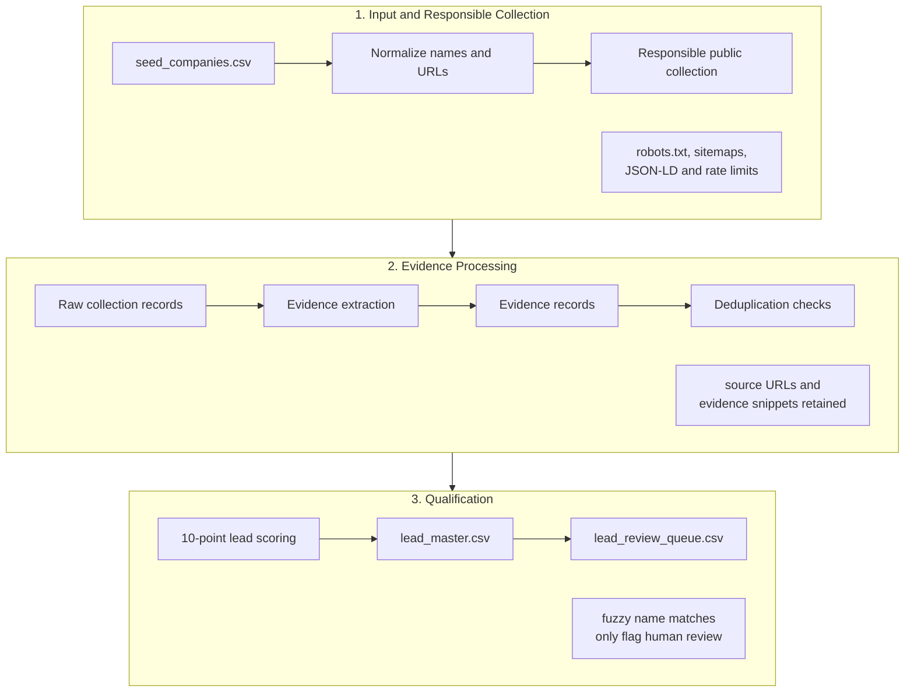

# Workflow Note

This project implements the Data Intelligence Intern challenge as a small, auditable pipeline. The goal is to collect only responsible public evidence, keep every claim traceable, and prepare lead drafts for human review.

## Workflow Diagram

## Collection

The workflow starts from `data/input/seed_companies.csv`. Each seed URL is normalized, then live collection is run only when `--collect-live` is enabled. The collector uses `urllib`, checks `robots.txt`, reads sitemap URLs when available, and prioritizes public homepage/about/product/blog/contact-style pages. It uses a descriptive user agent, timeouts, bounded retries, per-domain rate limiting, maximum response size, and a strict page limit per domain.

BeautifulSoup analyzes fetched HTML with Python's built-in `html.parser`. JSON-LD blocks, links, page title, meta description, Open Graph metadata, visible text length, and access-restriction signals are extracted through a shared helper. Script, style, noscript, template, and SVG content are removed from visible text so JavaScript source is not treated as evidence.

Playwright is an optional renderer for public HTTP 2xx HTML pages that robots.txt permits, are not access-restricted, have sparse visible text, and show an application-shell pattern such as `#root`, `#app`, or `#__next`. It opens only the same permitted URL, waits for a bounded rendering period, retrieves `page.content()`, and sends that rendered HTML back through the same BeautifulSoup analysis and evidence-extraction path.

## Extraction And Standardization

Facts are extracted from JSON-LD, metadata, Open Graph tags, public links, and visible page text. Each extracted fact is written to `data/evidence/evidence_records.csv` with fact type, value, source URL, evidence snippet, timestamp, confidence, and extraction method. Facts without a source URL and snippet are not emitted.

Before scoring, evidence is filtered and deduplicated. The pipeline excludes gated URLs such as `/password`, access-restriction text, empty metadata, schema-only labels such as `WebSite` or `BreadcrumbList`, repeated navigation/footer/cart text, Shopify boilerplate, generic newsletter-only text, repeated product-card snippets, customer reviews/testimonials, reviewer names, personal email addresses, and personal phone numbers. Evidence strength depends on distinct relevant official sources, not raw evidence count.

Company names are whitespace-normalized. URL normalization preserves original values and correction notes, repairs only obvious scheme mistakes such as `htps://`, removes `www.`, strips query strings/fragments, and trims trailing slashes. Missing information is kept as `unknown` or `not_available`; the pipeline does not invent facts.

Personal email addresses and personal phone numbers are intentionally not collected. Generic company contact routes may be retained only when they appear as public business contact evidence.

## Deduplication

Final normalized domains and observed redirects are used first because they are stronger evidence than names alone. Exact duplicate domains are grouped for review. Fuzzy company-name similarity only flags possible duplicates; it never automatically merges records. Parent companies and consumer brands remain separate unless a human decides otherwise.

## Scoring And Qualification

Leads are scored out of 10:

| Signal | Points |
| --- | ---: |
| Indian consumer D2C and target-category fit | 3 |
| Active accessible website or e-commerce | 2 |
| Clear product or service offering | 2 |
| Substantive marketing or growth signal | 2 |
| Supporting evidence quality | 1 |

Statuses are `qualified`, `pending_human_review`, `insufficient_information`, and `not_a_fit`. Score alone does not qualify a lead. `qualified` requires at least 7/10, full ICP-fit points, accessible official evidence, medium/high confidence, and no unresolved parent-brand, marketplace, geography, or duplicate ambiguity.

`pending_human_review` is used when a strong lead still has a business decision attached, such as parent-company versus brand-level outreach or marketplace/platform acceptance. `not_a_fit` is used for mandatory ICP failures such as B2B supplier or non-Indian company evidence. `insufficient_information` is used for gated-only, blocked, inaccessible, or too-limited public evidence.

## Evidence, Confidence, And Failures

Raw collection records go to `data/raw/collection_records.jsonl`, and the lighter audit log goes to `data/raw/collection_log.csv`. These retain source URLs, redirects, response codes, collection method, fallback reason, visible-text length, timestamps, and errors.

Blocked pages, robots.txt disallows, timeouts, HTTP failures, HTTP 429 rate limits, sparse pages, conflicting information, and missing facts are recorded instead of hidden. Browser rendering is never used for robots.txt disallow, authentication, CAPTCHA, paywall, HTTP 401/403/429 or access-denied pages.

The review queue includes only evidence-backed records ready for business review. Outreach, CRM insertion, and final approval stay outside the pipeline and require human judgment.

Codex assisted with implementation and documentation, but source verification, edge-case interpretation, and final qualification review were handled manually.
